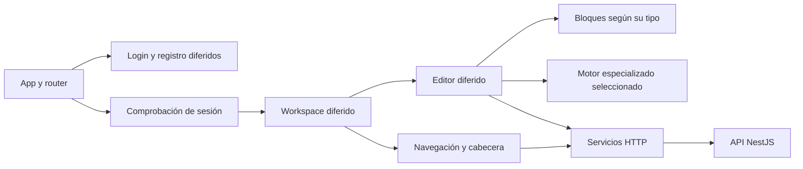

# 00 — Arquitectura y configuración

[Volver al índice](README.md)

Weave usa componentes standalone, plantillas Angular y estado reactivo con Signals.
Las versiones declaradas de Angular, TypeScript y bibliotecas están en
[package.json](../package.json), con resolución reproducible en `package-lock.json`.

## Arranque y rutas

[main.ts](../src/main.ts) instala compatibilidad global para ciertas bibliotecas y ejecuta
`bootstrapApplication`. [app.config.ts](../src/app/app.config.ts) configura router, HttpClient,
interceptor JWT y traducciones del visor PPTX. La raíz muestra un estado de carga durante la
navegación; el HTML inicial contiene una pantalla ligera antes de que Angular esté listo.

[app.routes.ts](../src/app/app.routes.ts) declara:

| Ruta | Carga y acceso |
| --- | --- |
| `/` | `WorkspaceComponent` por `loadComponent`; `authMatchGuard` comprueba sesión antes de cargarlo. |
| `/login` | Login por `loadComponent`. |
| `/register` | Registro por `loadComponent`. |
| Resto | Redirección a `/`. |

El guard del navegador comprueba la presencia del token. La validez criptográfica, expiración
y propiedad de los recursos se comprueban en NestJS.

## Entornos

| Archivo | Uso |
| --- | --- |
| `src/environments/environment.development.ts` | API `http://localhost:3000/api` y base de archivos local. |
| `src/environments/environment.ts` | Producción con API relativa `/api` y base relativa. |

[angular.json](../angular.json) reemplaza el entorno en la configuración de desarrollo.
En producción, servir `/api` y `/uploads` mediante el backend o el proxy correspondiente y
redirigir las rutas SPA al `index.html`. La SPA no lee el `.env` privado de NestJS o FastAPI.

## Reglas de dependencia

- `core/models` define contratos sin importar componentes del editor.
- `core/services` concentra estado y HTTP; no importa Univer, Excalidraw, PPTX ni motores PDF.
- `layout` administra navegación y paneles. Las herramientas grandes se difieren en sus plantillas.
- `editor/document-editor` selecciona un editor o tipo de bloque; cada implementación conserva su dominio.
- `shared` contiene controles e interacciones reutilizables.

Los `@defer` solo separan correctamente dependencias standalone que no se usan de forma
anticipada en el mismo archivo. Evitar referencias adicionales a un editor pesado desde
servicios centrales, constructores del layout o utilidades compartidas.
