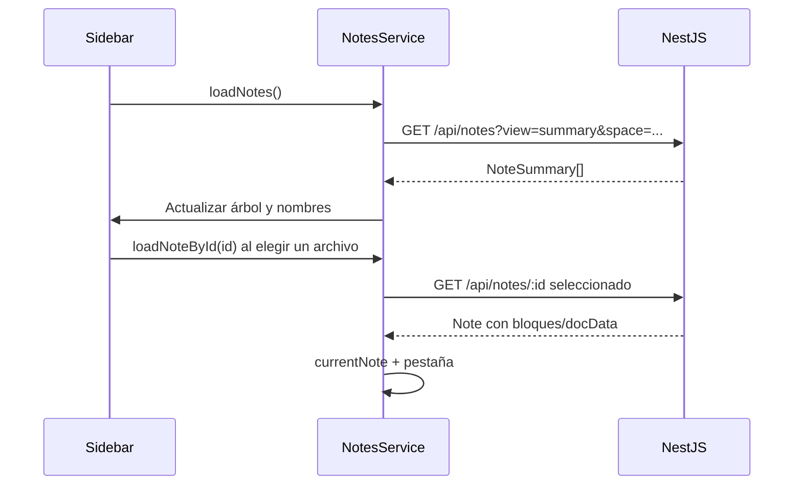

# 02 — Notas, pestañas y guardado

[Volver al índice](README.md)

Los contratos están en [note.model.ts](../src/app/core/models/note.model.ts),
[block.model.ts](../src/app/core/models/block.model.ts) y
[tab.model.ts](../src/app/core/models/tab.model.ts).

## Metadatos frente a contenido

`Note` contiene `blocks` y, cuando corresponde, `docData`. `NoteSummary` omite ambos. La barra
de espacios solo necesita metadatos: título, identificador, tipo, espacio y fechas.

[NotesService](../src/app/core/services/notes.service.ts) mantiene `notesList` como resúmenes y
`currentNote` como documento completo. La caché privada `loadedNotes` contiene documentos que
sí se cargaron. No construir un `Note` guardable a partir de un resumen: se podrían borrar los
bloques al enviar una estructura incompleta al servidor.

`loadNotes(space)` solo actualiza el listado. Abrir o expandir un directorio no selecciona
su primer archivo, ni cierra el documento y las pestañas que ya estaban abiertos. La carga del
contenido requiere seleccionar un archivo o una pestaña explícitamente; crear un archivo
también lo abre. Al iniciar sin selección se muestra una invitación a elegir o crear un documento.

Los contadores de carga evitan que una respuesta antigua reemplace la selección más reciente
o vuelva a introducir documentos tras limpiar la sesión. `isLoadingList`, `isLoadingNote` y
`noteLoadFailed` permiten mostrar estados explícitos durante la carga.

## Pestañas y edición

`openTabs` conserva metadatos de pestañas; abrir o cambiar una pestaña solicita el documento
completo por ID. `openTab` evita duplicar IDs. Cerrar la pestaña activa selecciona una vecina.
El zoom y el modo lectura son Signals independientes del contenido persistido.

Las mutaciones del editor pasan por `updateMeta`, `addBlock`, `updateBlockContent`,
`moveBlockTo`, `removeBlock` o `updateDocData`. No cambiar estructuras de un Signal por
referencia sin publicar el nuevo estado.

## Autoguardado

El servicio agrupa las ediciones por documento y sesión (`groupBy`), aplica `debounceTime(800)`
a cada grupo y envía `PUT /api/notes/:id`. Cada documento completa sus peticiones en orden
(`concatMap`); los documentos distintos pueden guardarse en paralelo (`mergeMap`). Una edición
en otra pestaña no descarta el guardado anterior ni cancela una escritura que ya empezó.

La comparación de contenido guardado se mantiene por ID. La respuesta de una escritura solo
reemplaza el documento de la caché si ese sigue siendo el snapshot más reciente enviado; si
hubo otra edición, conserva la versión local hasta completar su guardado. Reabrir una nota
pendiente usa ese documento completo de la caché, aunque el GET aún devuelva una versión vieja.
`saveStatus` distingue `saved`, `saving` y `unsaved`; una respuesta anterior no marca todos los
cambios como guardados. Ante un error se conserva el contenido y el estado sin guardar.

Los editores especializados deben pasar su `note._id` a `updateDocData` para que un evento
tardío no se atribuya a la pestaña activa equivocada. Solo un documento completo de la caché
puede alimentar un guardado de una pestaña en segundo plano.
Cerrar la última pestaña interna también permite enviar su cambio pendiente mediante el ID y
la caché completa; no necesita mantener una nota seleccionada. Limpiar la sesión cancela las
peticiones y grupos de guardado anteriores. Destruir el servicio libera la suscripción.

Word aplica además un debounce de 600 ms para preparar las imágenes antes de entregar `docData`
al servicio. Captura la última edición al cambiar/cerrar una pestaña interna, incluso si su
efecto de Angular aún no se ejecutó. Ver [paginación y edición Word](09-PAGINACION-Y-EDICION-WORD.md).
Esto no garantiza terminar una petición si se cierra el navegador o se corta la conexión.

Las pruebas de `notes.service.spec.ts` verifican guardado entre pestañas, escrituras en orden,
respuestas anteriores, reapertura de cambios pendientes y limpieza de sesión. Las de
[word-autosave.spec.ts](../src/app/editor/pure-doc-editor/word-autosave.spec.ts) montan un
componente Angular con su ciclo de vida y el servicio real; comprueban los PUT mediante
`HttpTestingController`, sin acceder a un MongoDB real.

El mecanismo actual no implementa edición colaborativa ni resolución de conflictos entre
dos navegadores. No interpretar el debounce como una transacción o un historial de versiones.
