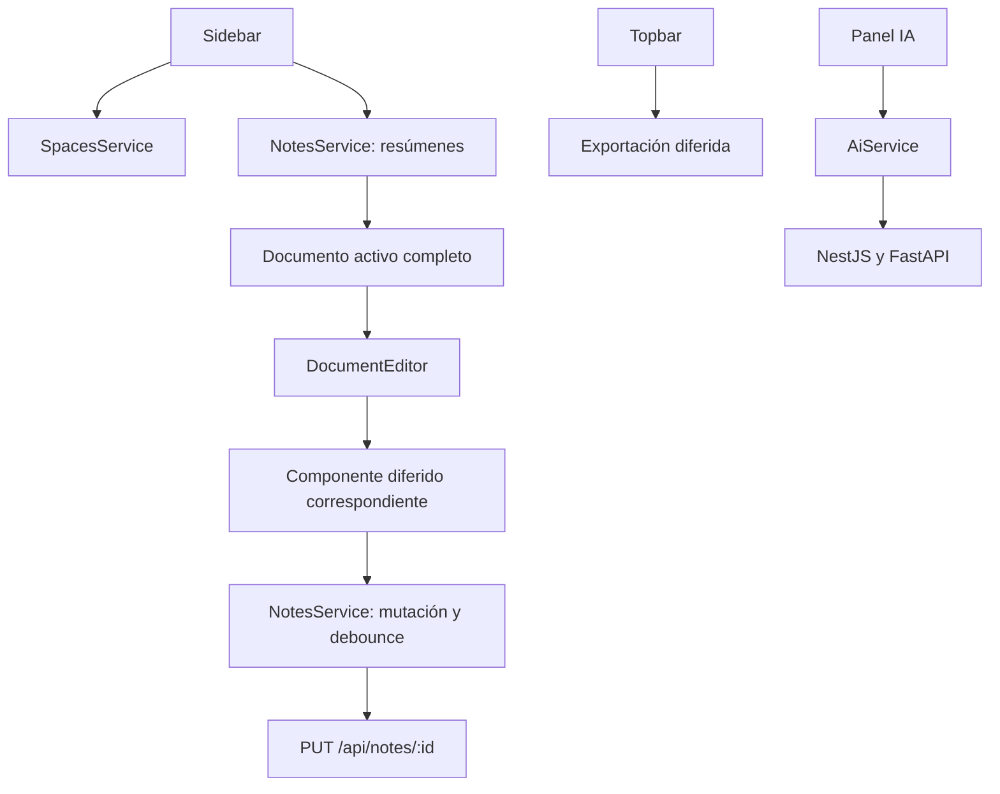

# 08 — Mapa de directorios y flujos

[Volver al índice](README.md)

| Ruta desde `frontend/` | Responsabilidad |
| --- | --- |
| `src/main.ts`, `src/index.html` | Bootstrap, compatibilidad global y primera pantalla de carga. |
| `src/app/app.*` | Raíz, tema y estado de navegación. |
| `src/app/app.config.ts`, `app.routes.ts` | Proveedores y rutas diferidas. |
| `src/app/core/models/` | Contratos de notas, resúmenes, bloques, espacios, usuarios e IA. |
| `src/app/core/services/` | Sesión, HTTP, estado, preferencias y carga de CSS de herramientas. |
| `src/app/core/guards/`, `interceptors/` | Comprobación de sesión e interceptor Bearer. |
| `src/app/pages/` | Login, registro y composición del workspace. |
| `src/app/layout/` | Sidebar, header, pestañas y panel IA. |
| `src/app/editor/document-editor/` | Host de documento y bloques. |
| `src/app/editor/pure-*-editor/` | Ediciones completas Word, hojas, canvas y PPTX. |
| `src/app/blocks/` | Implementaciones de cada tipo de bloque. |
| `src/app/export/` | Modal, contratos y estrategias de exportación. |
| `src/app/shared/` | Iconos, estados de carga y directiva de redimensionado. |
| `src/environments/` | URLs compiladas para desarrollo/producción. |
| `scripts/` | Control del grafo inicial y sus tests. |
| `guia-desarrollador/` | Documentación de arquitectura y operación. |

Agregar UI compartida en `shared`, preferencias en el servicio de layout, reglas de un motor
en su adaptación y contratos de red en `core/models`. No importar implementaciones pesadas
desde una utilidad global para evitar diseñar una frontera explícita.
