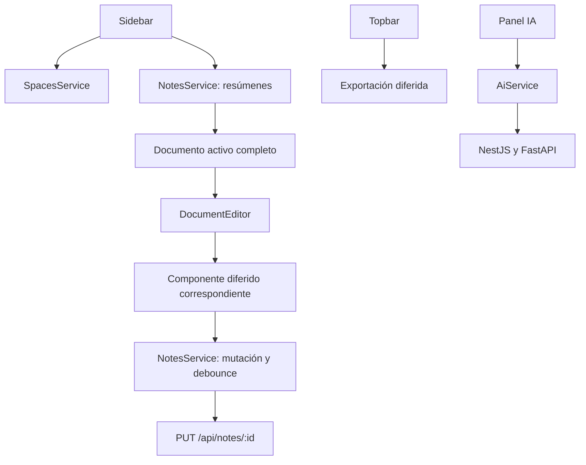

# 08 — Mapa de directorios y flujos

[Volver al índice](README.md)

| Ruta desde `frontend/` | Responsabilidad |
| --- | --- |
| `src/main.ts`, `src/index.html` | Bootstrap, compatibilidad global y primera pantalla de carga. |
| `src/app/app.*` | Raíz, tema y estado de navegación. |
| `src/app/app.config.ts`, `app.routes.ts` | Proveedores y rutas diferidas. |
| `src/app/core/models/` | Contratos de notas, resúmenes, bloques, espacios, usuarios e IA. |
| `src/app/core/services/` | Sesión, HTTP, estado, preferencias y carga de CSS de herramientas. |
| `src/app/core/guards/`, `interceptors/` | Comprobación de sesión e interceptor Bearer. |
| `src/app/pages/` | Login, registro y composición del workspace. |
| `src/app/layout/` | Sidebar, header, pestañas y panel IA. |
| `src/app/editor/document-editor/` | Host de documento y bloques. |
| `src/app/editor/pure-*-editor/` | Editores especializados Word, hojas y canvas; entrada de presentaciones. |
| `src/app/editor/pure-doc-editor/controllers/` | Lógica de Word dividida por responsabilidad y por instancia; el componente principal coordina eventos y ciclo de vida. |
| `src/app/editor/pure-sheet-editor/` | Libro Angular, motor de fórmulas, gráficos SVG, rastreo y objetos flotantes. |
| `src/app/editor/pure-sheet-editor/controllers/` | Controladores por instancia para libro, edición, interacción, viewport, formato, datos, gráficos y dibujo; el componente central coordina sus acciones. |
| `src/app/blocks/` | Implementaciones de cada tipo de bloque. |
| `src/app/export/` | Modal, contratos y estrategias de exportación. |
| `src/app/shared/` | Iconos, estados de carga y directiva de redimensionado. |
| `src/environments/` | URLs compiladas para desarrollo/producción. |
| `scripts/` | Control del grafo inicial y sus tests. |
| `guia-desarrollador/` | Documentación de arquitectura y operación. |

Agregar UI compartida en `shared`, preferencias en el servicio de layout, reglas de un motor
en su adaptación y contratos de red en `core/models`. No importar implementaciones pesadas
desde una utilidad global para evitar diseñar una frontera explícita.

El mapa interno del editor de hojas y los contratos persistidos se describen en
[Hojas de cálculo](18-HOJAS-DE-CALCULO.md). Las reglas de evaluación y portapapeles pertenecen
a sus servicios; las mutaciones e historial del libro pertenecen al coordinador del editor.

El formato académico de Word se concentra en `controllers/word-academic.controller.ts`,
`utils/apa-objects.ts`, `utils/apa-references.ts` y `components/word-academic-panel/`.
Contrato y uso: [APA 7](13-APA-TABLAS-FIGURAS-Y-REFERENCIAS.md).

El índice actualizable de Word está en `controllers/word-toc.controller.ts` y
`utils/table-of-contents.ts`; `utils/apa-layout.ts` centraliza márgenes y encabezados APA.

El formato APA completo utiliza `utils/apa-headings.ts`, `utils/apa-sections.ts`,
`utils/academic-notes.ts`, `utils/apa-reference-formats.ts` y `utils/apa-audit.ts`.
`controllers/word-structure.controller.ts` y `controllers/word-notes.controller.ts`
concentran secciones y notas sin aumentar el coordinador. El exportador se distribuye
entre `services/docx-*`; véase [DOCX](14-EXPORTACION-DOCX-WORD.md).
